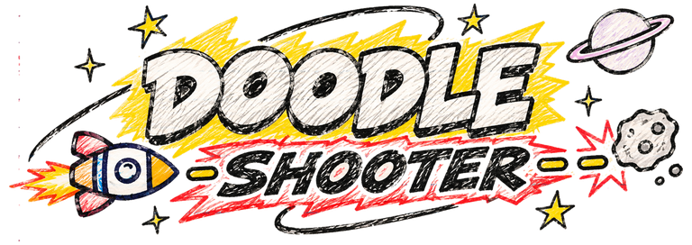

# DOODLE SHOOTER  (Wii homebrew)



A side-view space shooter for the Nintendo Wii, played with the **Wii Classic Controller**, that looks like a kid
doodled it on a page of school notebook paper: crayon-coloured rockets and monsters, wobbly felt-pen outlines,
handwriting everywhere. The page "boils" like stop-motion animation while the action stays a smooth **60 fps** in **16:9**.

Fly your hand-drawn rocket across the wrap-around **Notebook Nebula**, fight enemies coming from both sides, keep your
multiplier climbing, and take down the **Hexacore**.

## Controls (Classic Controller)

| Button | Action |
|---|---|
| Left stick / D-Pad | fly |
| **A** | **Pulse Blaster** - hold for rapid fire. Watch the heat ring: overheat and it locks up for a second |
| **B** | **Circle Shield** - hold to spin twin energy sabres around the ship. Slices enemies and cuts bullets out of the air |
| **X** | **Swarm Missiles** - homing missiles that lock on to 3 out of every 4 baddies on screen |
| **Y** | **Power Lazer** - a short charge, then a screen-wide beam that pierces everything |
| **L / R** | turn the ship around to shoot behind you (on the title screen: pick the level) |
| **ZL / ZR** | boost: a quick dash. Two charges; each one recharges on its own after a couple of seconds |
| + | pause (resume / restart / sound on-off / quit) |
| - | switch between full 16:9 and a letterboxed picture for a 4:3 TV |
| HOME | quit |

B, X and Y use **energy** (the yellow bar). Destroyed enemies drop **yellow diamonds** - fly near them and they
get pulled in to refill it. Red hearts give you back a heart (your shields).

**Scoring:** every kill raises your **multiplier** (up to 30x); getting hit halves it. Kills within a couple of
seconds form a **chain** (big chains pay a bonus), and clearing a wave without getting hit is a **PERFECT** bonus.
Your rank (S / A / B / C) is shown at the end of the level.

## Level 1: Notebook Nebula

Plain ruled notebook pages with faint pencil stars, planets and a smiley moon. The pages scroll slower than the
action (and drift a little as you climb and dive) while the doodles scroll faster, for a sense of depth.

10 waves: blue spiky **Shards** that hunt you down (they shake and shout "!" before they lunge), mint **Zip** flocks,
grumpy red **Spores** that spit bullet fans, wiggly **Serpent** caterpillars that pop segment by segment when you
get the head, and the boss, the **Hexacore**, a furious yellow hexagon with six crystal shields that starts steaming
mad at half health.

## Build it (no toolchain needed on your computer)

Push this folder to a GitHub repository. The included GitHub Actions workflow
(`.github/workflows/build.yml`) builds it in the official devkitPro container on every push.
Open the run under the **Actions** tab and download the **doodle-shooter-wii** artifact; it contains `boot.dol`
and an `apps/doodleshooter/` folder (boot.dol + meta.xml + icon.png) for the Homebrew Channel.

To build locally instead: install devkitPro (`sudo dkp-pacman -S wii-dev`) and run `make`.

## Run it in Dolphin

1. **Controllers > Wii Remote 1 = Emulated Wii Remote > Configure > Extension = Classic Controller**, then map
   the Classic Controller's buttons **and its left stick** (set this before starting the game).
2. Config > Wii: **Aspect Ratio = 16:9**. Graphics: Aspect Ratio **Auto**, VSync on.
3. Open `boot.dol`.
4. Because everything is real geometry, raising Dolphin's **internal resolution** (2x / 3x) makes the
   game look razor sharp. On Android, 2x is a good balance.

On a real Wii: copy `apps/doodleshooter/` to the `apps` folder on the SD card.

## Level 2: Graph Paper Galaxy

A page of graph paper, three new doodles mixed in with the level 1 crew, and a new boss:

* **Saucers**: little green aliens in flying saucers that hover above or below you and fire 3-shot bursts
  (their rim lights go red just before).
* **Fuse bombs**: grumpy bombs that drift at you with a lit fuse. Pop them before it burns down (they flash red),
  or they burst into a ring of bullets.
* **Blobs**: one-eyed green blobs that split into two little blobs when you pop them.
* **The Big Head** (boss): a pencil drawing inked in bold and coloured in with crayon, hoop earrings and all, with six
  crazy purple tentacles. She whips her tentacles at you, spits bullet fans, flings rings of bullets from her earrings and
  hiccups out little blobs. Her googly eyes follow you around and her jaw drops open when she cackles.
  At half health she gets MAD (steam, anger mark, rolling eyes, faster attacks, two tentacles at once).

## Level 3: Cut-Out Cosmos

A collage of construction paper: planets, moons, clouds, dangling stars and rolling hills, each cut out and glued on
in layers, with crayon doodles drawn on top. Three new (and meaner) enemies, and a new boss:

* **Scissors**: creep up on you, open wide (a red "!" flashes), then SNAP forward in a straight dash. Sidestep the snap.
* **Paper planes**: fly in V squadrons, loop back round, and fire at you as they pass.
* **Pinwheels**: park beside you, spin up, and spray a spiral of bullets for a couple of seconds.
* **The Pencil** (boss): a yellow pencil with a pink eraser and googly eyes. Its big move is trying to **erase you**: it
  flips round, a pink dotted line tracks you, then the line turns **red** with an X where it will finish - that's your
  cue to get off the line before it rubs straight through. Anything else the eraser passes over gets rubbed out too:
  enemies, bullets, crystals and the crayon doodles on the page (they stay gone, leaving scuffed patches).
  It also scribbles zig-zag pencil lines that hurt to touch while fresh, flicks fans of graphite at you, and sketches
  new enemies into existence. At half health it shouts "ERASE EVERYTHING!" and rubs twice in a row.

## Adding levels

Levels live in `source/levels.c`. Copy the LEVEL 1 block, give it a new name, colours and terrain seed, and
write its waves (each wave is a list of `{enemy type, count, side, delay}` groups). The title screen gets a
level picker automatically once there is more than one level, and clearing a level continues to the next one.

## Testing (no Wii needed)

`make test` (or `sh tools/run_tests.sh`) builds the game natively and runs a harness that:

* software-renders the exact triangle list the Wii's GPU receives and saves screenshots to `tools/out/`
* checks controls (turning, overheating, energy costs, blade hold/release, pause)
* plays the whole level with bots of three skill levels over many random seeds (the "clumsy" bot clears
  about 60% of the time; doing nothing loses)
* measures CPU time and triangle counts per frame

`sh tools/run_tests.sh reel` also renders a gameplay preview video with the game's own sounds.

> **Honest note:** the game was tested natively as above, and `source/main.c` (the only Wii-specific file) was
> type-checked for the Wii's PowerPC CPU against the real libogc headers, but it has not been run on a Wii or in
> Dolphin yet. If something looks off, the likely spot is the GX setup in `video_init()`.

## Layout

```
source/game.c        rules: ship, weapons, enemies, boss, waves, scoring, menus
source/draw.c        all rendering (low-poly models, glow, particles, HUD, screens)
source/levels.c      level definitions (add new levels here)
source/gfx.c/.h      triangle-list builder, crayon/paper textures, wobbly pen lines, handwriting
source/font_data.h   the handwriting font atlas (made by tools/make_font.py)
source/audio.c/.h    synthesized sound effects (no audio files)
source/main.c        the Wii layer: GX graphics, Classic Controller, ASND audio
tools/test.c         native test harness, software rasterizer, bots, preview recorder
```

## Credits

Handwriting font: **Gloria Hallelujah** by Kimberly Geswein, used under the SIL Open Font License 1.1
(`tools/fonts/OFL.txt`).

Ship, logo, the Big Head and the Pencil: hand-drawn art in `tools/art/` (`python3 tools/make_art.py` cuts them out of the paper and bakes them
into `source/art_data.h`).
